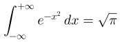
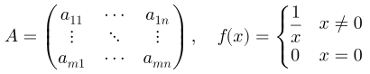
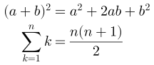
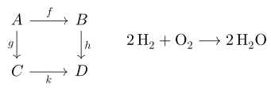

# 

It is a dynamic, cross-platform, and embeddable LaTeX rendering library. Its main purpose is to display mathematical formulas written in LaTeX, and it sets the text, tables, lists and displays around them too. The engine needs no graphics library, it records what it draws, and graphics backends for Cairo, Qt, Skia and Windows GDI+ are included for applications that want to draw directly.

This is a fork of [NanoMichael/MicroTeX](https://github.com/NanoMichael/MicroTeX) by Nano Michael, from its `openmath` branch. The layout engine, the symbol tables and the graphics interface are his work, and the credit for them is his. The fork is the engine of [gridmicrotex](https://github.com/adayim/gridmicrotex), which renders LaTeX in R graphics, and the sources in `lib/` are kept in step with the copy that package ships. The build files (`CMakeLists.txt`, `meson.build`), [`lib/host_defaults.cpp`](lib/host_defaults.cpp), `lib/microtexapi.h` and `lib/wrapper/` are this fork's own.









These were drawn by [`example/svg`](example/svg/svg_main.cpp), with Latin Modern Math. [`example/samples`](example/samples/README.md) has the 36 formulas of [`res/SAMPLES.tex`](res/SAMPLES.tex), each with its source and its SVG.

# What this fork changes

- **A new LaTeX front end.** A lexer, macro expander, parser and lowering that read LaTeX as TeX does: catcodes and spaces, groups, `\def`, `\newcommand`, `\let`, `\newif`, conditionals, xparse's `\NewDocumentCommand`, `\usepackage`. Malformed input is drawn with a warning at its line and column instead of failing.
- **Commands as LaTeX files.** What is not written in C++ is LaTeX, in [`res/tex`](res/tex): `prelude.tex` and packages such as amsmath, amssymb, amsthm, mathtools, braket, physics, commath, tensor, slashed, booktabs, makecell and graphicx, and `katex` for the names only KaTeX has. The engine reads no file, the host hands over their text, so a host can add packages of its own. Built in: subsets of siunitx and mhchem, `tikz-cd` and amscd diagrams, tabularray tables, `bm` and `cancel`.
- **Three input modes** (`InputMode`): *math*, a formula; *mixed*, a label of text with `$math$` in it; *document*, a document body with paragraphs, headings, lists, tables, theorems, floats and equation numbers (`\label`, `\ref`, `subequations`, `numcases`).
- **Fonts straight from OpenType files.** A math font is read from its `.otf` with FreeType and its MATH table, outlines included. There are no CLM files and no FontForge. Text fonts can be added and named in the document with `\setmainfont` and friends. Fira Math, Latin Modern Math, TeX Gyre DejaVu Math and XITS are in [`res`](res).
- **A recording backend.** `Graphics2D_Recorder` ([`lib/graphic/graphic_recorder.h`](lib/graphic/graphic_recorder.h)) keeps every draw operation as data: glyph outlines or glyph ids, lines, rectangles, text runs, named marks and image boxes. Any vector output can be made from it; `example/svg` is one.
- **Hooks for the host**, for images (`\includegraphics`) and fonts named in a document ([`lib/front/hooks.h`](lib/front/hooks.h)).
- **Right-to-left text**, reordered with FriBidi when it is built in.
- **TeX's own layout rules** where TeX has one, checked against pdfLaTeX output: the row spacing of matrices and alignments, text style in arrays, equation numbers.
- **Safer and more portable.** The engine is tested under AddressSanitizer and UBSan and fuzzed with libFuzzer on every push.

# Status

| Part | State |
|------|-------|
| `lib/` (the engine) | Built and tested by CI with g++ and clang++: the tests under AddressSanitizer and UBSan, the strict warnings, and both fuzzers. |
| `example/svg` | Builds and runs in CI, on a formula and on every sample of `res/SAMPLES.tex`; made the pictures here. |
| `lib/wrapper` (the C API) | Builds with `-DHAVE_CWRAPPER=ON`; a test of it runs in CI. |
| `example/memcheck` | Builds and runs in CI. |
| `platform/cairo`, `platform/qt` | Build with CMake and Meson (Cairo 1.18, Pango 1.52, Qt 5.15); checked by hand, not by CI, and no program has been run with them. |
| `platform/gdi_win`, `example/win32` | Compile-checked with MinGW, not run. |
| `platform/skia` | Inherited from upstream, not built (no Skia here). |
| `lib/meson.build` | Builds the engine, with Cairo and Qt; checked by hand, not by CI. |

Removed, because they no longer built: the Flutter and WebAssembly ports and the GTK, gtkmm and Qt demo programs (they loaded fonts as CLM data, a format the engine no longer reads), the GTK widget (it uses the old `tex` namespace), `build.zig` (its list of sources was out of date), and the CLM tools and data.

# Build

You need a C++17 compiler, CMake 3.16 and FreeType (found by `pkg-config`). FriBidi is optional.

```sh
cmake -S . -B build -DBUILD_EXAMPLE_SVG=ON
cmake --build build -j
./build/example/svg/microtex-svg --display '\int_0^1 \frac{x^2}{2}\,dx' out.svg
```

`microtex-svg` takes `--res`, `--font`, `--size`, `--width`, `--mode math|mixed|document`, `--display` and `--background`; run it with no arguments for the list. It finds the fonts and the LaTeX files in `./res`, which CMake copies next to it. Text is laid out with FreeType and drawn as outlines too, in XITS and Fira Math from `res`; `--text-font`, `--sans-font`, `--mono-font` and `--fallback` name others (a CJK font, say), and a character no font has is left blank. A font with colour layers (COLR/CPAL) is drawn in colour: [`res/twemoji`](res/twemoji/README.md) is one, for emoji. `--samples FILE --outdir DIR` draws every formula of a samples file, and `--index FILE.md` writes a page of them; [`example/samples`](example/samples/README.md) was made so, with `-DHAVE_LOG=OFF` to keep the box trees out of the output:

```sh
./build/example/svg/microtex-svg --width 720 --background white --fallback res/twemoji/Twemoji.Mozilla.ttf \
    --samples res/SAMPLES.tex --outdir example/samples/svg --index example/samples/README.md
```

| Option | Default | |
|--------|---------|---|
| `MICROTEX_BIDI` | OFF | Right-to-left reordering with FriBidi. |
| `BUILD_STATIC` | OFF | A static library. The examples and the tests link it, because the recorder and the package hooks are internal headers that a shared library hides. |
| `HAVE_CWRAPPER` | OFF | The C API in `lib/wrapper`. |
| `HAVE_LOG` | ON | Print the parse result and the box tree while running. |
| `GLYPH_RENDER_TYPE` | 0 | 0 glyph outlines and typefaces, 1 outlines only, 2 typefaces only. |
| `BUILD_EXAMPLE_SVG`, `BUILD_EXAMPLE_MEMCHECK` | OFF | The examples. `memcheck` parses a samples file such as [`res/SAMPLES.tex`](res/SAMPLES.tex) on a graphics context that draws nothing, for valgrind. |
| `CAIRO`, `QT`, `SKIA`, `GDI`, `BUILD_EXAMPLE_WIN32` | OFF | The graphics backends and the Windows example. |
| `MICROTEX_TESTS`, `MICROTEX_FUZZ` | OFF | The tests and the fuzzers ([`test/`](test/README.md)). |

Meson builds the engine and the Cairo, Qt and GDI+ backends too (`meson setup _build -DCAIRO=true -DQT=true`), but not the C API, the examples or the tests. CMake is what CI runs.

# How to use

A host does these before it can draw (the second is optional):

1. **Names a platform**, a `PlatformFactory` that creates fonts and text layouts: the engine asks it to measure and draw text. `example/svg` has one that does both from font files with FreeType.
2. **Answers two measurements** the recorder may ask for, `microtex::measure_cached_text_width()` and `microtex::measure_glyph_advance()` (declared at the end of `graphic_recorder.h`). Only a flipped draw (`\reflectbox`) needs them, and [`lib/host_defaults.cpp`](lib/host_defaults.cpp) gives estimates as weak symbols, so this step is for a host that wants exact ones: it defines the functions.
3. **Hands over the LaTeX files** of `res/tex`.
4. **Starts the engine** with a math font file.

```c++
#include "front/packages.h"
#include "graphic/graphic_recorder.h"
#include "microtex.h"

using namespace microtex;

PlatformFactory::registerFactory("mine", std::make_unique<MyPlatform>());
PlatformFactory::activate("mine");

front::setPrelude(prelude_tex_text);                 // res/tex/prelude.tex
front::registerPackage("amsmath", amsmath_sty_text); // each res/tex/*.sty, by name

MicroTeX::init(FontSrcOtf("res/lm-math/latinmodern-math.otf"));

std::unique_ptr<Render> render(MicroTeX::parse(
    R"(\int_0^1 \frac{x^2}{2}\,dx)",  // LaTeX, in UTF-8
    0,                                // wrap lines at this width, 0 for no limit
    20,                               // text size, in pixels
    20 / 3.f,                         // space between lines, in pixels
    0xFF000000u));                    // colour, as ARGB

Graphics2D_Recorder g2;
render->draw(g2, 0, 0);
for (const DrawRecord& d : g2.records()) {
  // d.type is PATH, LINE, RECT, FILL_RECT, TEXT, MARK, IMAGE ...
}

MicroTeX::release();
```

`parse` takes more arguments, among them the `InputMode` and the style (`OverrideTeXStyle`, to set a formula in display style). Problems found while reading the input are in `front::lastDiagnostics()`, each with its line and column.

To draw without the recorder, implement `Graphics2D`, `Font` and `TextLayout` of [`lib/graphic/graphic.h`](lib/graphic/graphic.h), as the backends in `platform/` do.

## The C API

With `-DHAVE_CWRAPPER=ON` the engine has a C interface for other languages ([`lib/wrapper/cwrapper.h`](lib/wrapper/cwrapper.h)): `microtex_init(font file)`, `microtex_setPrelude()` and `microtex_registerPackage()` for the LaTeX files, `microtex_parseRender()` and `microtex_getDrawingData()`, which returns the draw commands as a byte stream. Text layouts are done by callbacks of the host.

## Fonts

`MicroTeX::init()` takes one math font, a `.otf` with a MATH table; `MicroTeX::addFont()` adds more, math or text. The fonts in `res` keep their own licences, which sit in their folders. [`res/twemoji`](res/twemoji/README.md) is a colour emoji font (Twemoji, CC-BY 4.0) that only the examples use.

# Credits

MicroTeX is by [Nano Michael](https://github.com/NanoMichael) and its contributors. The changes in this fork are by [Alim Dayim](https://github.com/adayim).

# License

This project is under the [MIT](https://opensource.org/licenses/MIT) license, Copyright (c) 2020 Nano Michael; see [LICENSE](LICENSE). The fonts under `res` are under their own licenses.
