# Samples

The formulas of [`res/SAMPLES.tex`](../../res/SAMPLES.tex), drawn by [`microtex-svg`](../svg/svg_main.cpp) with `--samples`; the warnings are the engine's, with their line and column in the formula.

## 1. doge

```tex
%doge
当 🐶️ \rightarrow 0 时\\
\begin{array}{|l|l|}
\hline
\sin 🐶️ \sim 🐶️ & \tan 🐶️ \sim 🐶️\\
\ln(1 + 🐶️) \sim 🐶️ & e^🐶️ - 1 \sim 🐶️\\
\arcsin 🐶️ \sim 🐶️ & \arctan 🐶️ \sim 🐶️\\
\log_a(1+🐶️) \sim \frac{🐶️}{\ln a} & a^🐶️ - a \sim 🐶️\ln a\\
1 - \cos 🐶️ \sim \frac 12 🐶️^2 & \ln\left(🐶️+\sqrt{1+🐶️^2}\right) \sim 🐶️\\
🐶️-\sin🐶️ \sim \frac 16 🐶️^3 & \tan 🐶️ - 🐶️\sim \frac 13 🐶️^3\\
(1+🐶️)^\alpha-1 \sim \alpha🐶️ & \arcsin 🐶️ - 🐶️ \sim \frac 16 🐶️^3\\
\hline
\end{array}
```

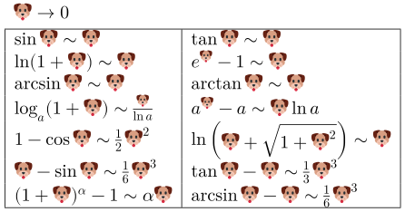

## 2. char

```tex
%char
\text{
\char"68\char"65\char"6c\char"6c\char"6f\char"20\char"77\char"6f\char"72\char"6c\char"64\char"21\char"2665\char"fe0f\\
\char"4f60\char"597d\char"ff0c\char"4e16\char"754c\char"ff01\char"2665\char"fe0f\\
你好，世界！♥️\\
Unicodes with ZWJ:
\char"1f468\char"200d\char"1f469\char"200d\char"1f467
\char"1f468\char"200d\char"1f466
}
```

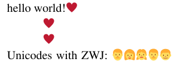

## 3. Logo

```tex
%Logo
\text{\mu\kern-.1em\TeX is a \LaTeX rendering library.}
\\
\text{\MicroTeX is a \LaTeX rendering library.}
\\
F(\omega)=\int_{-\infty}^{+\infty}f(t)e^{-i\omega_nt}dt
```

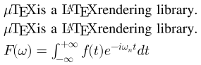

## 4. Text

```tex
%Text
\text{What is real? How do you define 'real'?
If you're talking about what you can feel,
what you can smell, what you can taste and see,
then 'real' is simply electrical signals
interpreted by your brain.
\textbf{― Morpheus The Matrix}}
```

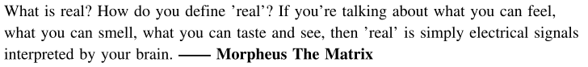

## 5. Chinese

```tex
%Chinese
\text{这是一个 \LaTeX 排版引擎。}\\
\textsf{这是一个 \LaTeX 排版引擎。}\\
\textbf{这是一个 \LaTeX 排版引擎。}\\
\textit{这是一个 \LaTeX 排版引擎。}\\
\because\left\{
\begin{array}{ll}
v = v_球 + v_车\\
F = ma\\
E = \frac 12 mv^2
\end{array}
\right.
\\
\text{则有：}
\\
E = E_球 + E_车 = \frac 12mv^2
```

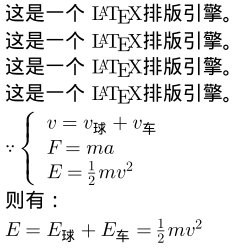

## 6. Emoj test

```tex
%Emoj test
F(x) = \displaystyle\int_🙂^😀f(x)dx\\
\log_😄️😅️=💧️\\
\displaystyle\sum_{i=0}^\infty💰️=🤣️\\
\prod_{i=0}^\infty i\times💰️=😭️\\
%ZWJ
\char"1f468+\char"1f469+\char"1f466=👨‍👩‍👦
```

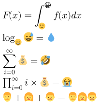

## 7. Text size

```tex
%Text size
\tiny{\text{tiny text, scale = 0.5}}\\
\scriptsize{\text{scriptsize text, scale = 0.7}}\\
\footnotesize{\text{footnotsize, scale = 0.8}}\\
\small{\text{small text, scale = 0.9}}\\
\normalsize{\text{normal text, scale = 1}}\\
\large{\text{large text, scale = 1.2}}\\
\Large{\text{Large text, scale = 1.4}}\\
\LARGE{\text{LARGE text, scale = 1.8}}\\
\huge{\text{huge text, scale = 2}}\\
\Huge{\text{Huge text, scale = 2.5}}
\\
% resize
\resizebox{1em}{!}{\LaTeX}
\resizebox{!}{1em}{\LaTeX}
\resizebox{1em}{0.5em}{\LaTeX}
```

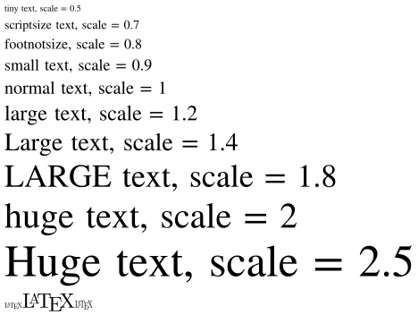

## 8. Framed boxes

```tex
%Framed boxes
\fbox{\text{A framed box.}}\\
\doublebox{\text{A dobule framed box.}}\\
\shadowbox{\text{A shadow framed box.}}\\
\ovalbox{\text{An oval framed box.}}
```

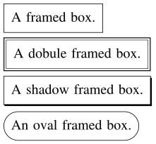

## 9. Left & middle & right

```tex
%Left & middle & right
\left\{ x \middle| x \middle( x \middle) \ne\frac12\right\}
\\
\left.
\middle[
a^2+b^2
\middle]
+
\middle[
\sum\limits_{i=1}^{n}c_i
\middle]
\right.
\\
a=\left\{\Delta
\middle|
x=\frac{-b\pm\sqrt{b^2-4ac}}{2a}
\middle|
\sum_{x=0}^{+\infty}
\right\}*b
\\
\lambda_l = \lim_{q \to 0^+}P\left(X_2 \leq F_2^{(-1)}(q)
\middle|
x_1 \leq F_1^{(-1)}(q)
\right)
\\
\lambda_l = \lim_{q \to 0^+}P\bigl(X_2 \leq F_2^{(-1)}(q)
\big|
x_1 \leq F_1^{(-1)}(q)
\bigr)
\\
{n \choose x}
{n \brack x}
{n \brace x}
{n \bangle x}
\\
\binom{n}{k} = \frac{n!}{k!(n-k)!}
```

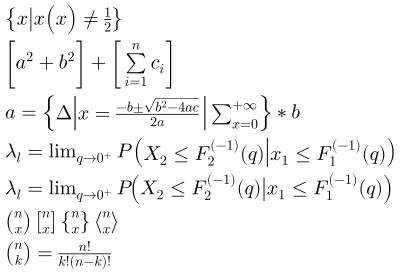

## 10. Fractions

```tex
%Fractions
\sfrac 12 + x + e^{\sfrac 12}\\
\ln e^{\sfrac 12} = \sfrac 12
\\
{x \above 10pt y}
{x \atop y}
{x \over y}
\frac{x}{y}
\\
{a \overwithdelims [] b}
{a+1 \overwithdelims .| b+2} + x
\\
{a+1 \atopwithdelims [] b}
{a+1 \atopwithdelims .| b} + x
\\
{a+1 \abovewithdelims [] 10pt b}
{a+1 \abovewithdelims .| 10pt b} + x
\\
x=\frac{-b\pm\sqrt{b^2-4ac}}{2a}
\\
\genfrac[]{1pt}{0}{a+b}{c}a
\\
\genfrac[]{0pt}{0}{a+b}{c}b
\\
\frac{1}{1+
\frac{1}{1+x}}+a
\\
\frac{1}{1 + x}+a
\\
\frac{1}{1+
\frac{1}{1+
\frac{1}{1+
\frac{1}{1+
\frac{1}{1 + x}}}}}
\\
\cfrac{1}{1+
\cfrac{1}{1+
\cfrac{1}{1+
\cfrac{1}{1+
\cfrac{1}{1 + x}}}}}
```

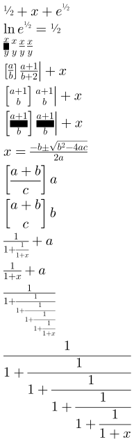

## 11. Radicals

```tex
%Radicals
\sqrt[4]{a}\\
\sqrt[\sum_{x=0}^{\infty}]{a}\sqrt{f}\\
\sqrt[\sum_{x=0}^{\infty}]{\sum\limits_{M=0}^{\xrightarrow[under]{above}}}
```

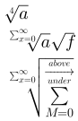

## 12. X arrows

```tex
%X arrows
A\xleftarrow[\text{under}]{\text{above}}B
A\xrightarrow[\text{under}]{\text{above}}B\\
A\xleftrightarrow[\text{under}]{\text{above}}B
A\xRightarrow[\text{under}]{\text{above}}B\\
A\xLeftarrow[\text{under}]{\text{above}}B
A\xLeftrightarrow[\text{under}]{\text{above}}B\\
A\xhookleftarrow[\text{under}]{\text{above}}B
A\xhookrightarrow[\text{under}]{\text{above}}B\\
A\xmapsto[\text{under}]{\text{above}}B\\
A\xrightharpoondown[\text{under}]{\text{above}}B
A\xrightharpoonup[\text{under}]{\text{above}}B\\
A\xleftharpoondown[\text{under}]{\text{above}}B
A\xleftharpoonup[\text{under}]{\text{above}}B\\
A\xrightleftharpoons[\text{under}]{\text{above}}B
A\xleftrightharpoons[\text{under}]{\text{above}}B
```

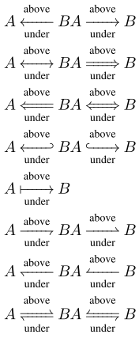

## 13. Over and under arrows

```tex
%Over and under arrows
\overrightarrow{a+b+c}\\
\overleftarrow{a+b+c}\\
\overleftrightarrow{a+b+c}\\
\underrightarrow{a+b+c}\\
\underleftarrow{a+b+c}\\
\underleftrightarrow{a+b+c}
```

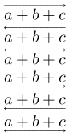

## 14. Over and under delimiters

```tex
%Over and under delimiters
\overbrace{a+b-c\div e\times f}^\text{total}\\
\underbrace{a+b-c\div e\times f}_\text{total}\\
\overbrace{a+b}\underbrace{a+b}\\
\overbrack{a+b-c\div e\times f}\\
\underbrack{a+b-c\div e\times f}\\
\overbrack{a+b}\underbrack{a+b}\\
\overparen{a+b-c\div e\times f}\\
\underparen{a+b-c\div e\times f}\\
\overparen{a+b}\underparen{a+b}\\
\overline{a+b-c\div e\times f}\\
\underline{a+b-c\div e\times f}
```

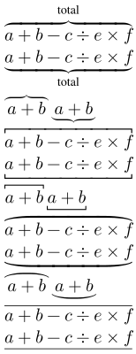

## 15. Delimiters

```tex
%Delimiters
\Biggl(\biggl(\Bigl(\bigl(()\bigr)\Bigr)\biggr)\Biggr)
\\
\Biggl[\biggl[\Bigl[\bigl[[]\bigr]\Bigr]\biggr]\Biggr]
\\
\Biggl\{\biggl\{\Bigl\{\bigl\{\{\}\bigr\}\Bigr\}\biggr\}\Biggr\}
\\
\Biggl|\biggl|\Bigl|\bigl|||\bigr|\Bigr|\biggr|\Biggr|
```

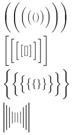

## 16. Cumulative scripts

```tex
%Cumulative scripts
M_x''' M'''_x M^{'''}_x M_x{'''} M^{\prime\backprime}
\\
M`M``M```M````
\\
M'M''M'''M''''M'''''
\\
M'^y M^y' M`^y M^y`
```

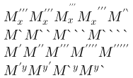

## 17. Sidesets

```tex
%Sidesets
\sideset{_x^y}{_a^b}\int_{M=0}^na \\
\sideset{_x^y}{_c^d}\sum_{M=0}^n \\
\int\limits_{M=0}^n \\
\sideset{_*^*}{_*^*}\prod_{i=0}^\infty x_i \\
\sideset{^\backprime}{'}
\sum_{x=1}^{\infty} x
\sideset{a_1^2}{}\sum_{x=1}^\infty x_0
\\
\sideset{_\text{left bottom}'''}{_{\text{right bottom}}'''}
\sum_{\text{quite long text}}^\infty x
\\
\sideset{}{'}
\sum_{n<k,\;\text{$n$ odd}} nE_n
\\
\sideset{}{'}
\sum^{n<k,\;\text{$n$ odd}} nE_n
\\
```

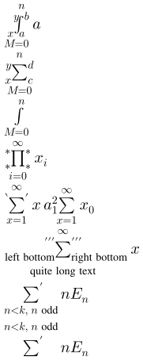

## 18. Font styles

```tex
%Font styles
\textcolor{magenta}{mathbf:}\\
\mathbf{0123456789}\\
\mathbf{ABCDEFGHIJKLMNOPQRSTUVWXYZ}\\
\mathbf{abcdefghijklmnopqrstuvwxyz}\\
\mathbf{\Alpha\Beta\Gamma\Delta\Epsilon\Zeta\Eta\Theta\Iota
\Kappa\Lambda\Mu\Nu\Xi\Omicron\Pi\Rho\Sigma\Tau
\Upsilon\Phi\Chi\Psi\Omega\nabla}\\
\mathbf{\alpha\beta\gamma\delta\epsilon\zeta\eta\theta\iota
\kappa\lambda\mu\nu\xi\omicron\pi\rho\sigma\tau
\upsilon\phi\chi\psi\omega}\\
\mathbf{\partial\varepsilon\varkappa\varphi\varrho\varpi
\Digamma\digamma}\\
\textcolor{magenta}{mathrm:}\\
\mathrm{0123456789}\\
\mathrm{ABCDEFGHIJKLMNOPQRSTUVWXYZ}\\
\mathrm{abcdefghijklmnopqrstuvwxyz}\\
\mathrm{\Alpha\Beta\Gamma\Delta\Epsilon\Zeta\Eta\Theta\Iota
\Kappa\Lambda\Mu\Nu\Xi\Omicron\Pi\Rho\Sigma\Tau
\Upsilon\Phi\Chi\Psi\Omega\nabla}\\
\mathrm{\alpha\beta\gamma\delta\epsilon\zeta\eta\theta\iota
\kappa\lambda\mu\nu\xi\omicron\pi\rho\sigma\tau
\upsilon\phi\chi\psi\omega}\\
\mathrm{\partial\varepsilon\varkappa\varphi\varrho\varpi
\Digamma\digamma}\\
\textcolor{magenta}{mathcal:}\\
\mathcal{0123456789}\\
\mathcal{ABCDEFGHIJKLMNOPQRSTUVWXYZ}\\
\mathcal{abcdefghijklmnopqrstuvwxyz}\\
\mathcal{\Alpha\Beta\Gamma\Delta\Epsilon\Zeta\Eta\Theta\Iota
\Kappa\Lambda\Mu\Nu\Xi\Omicron\Pi\Rho\Sigma\Tau
\Upsilon\Phi\Chi\Psi\Omega\nabla}\\
\mathcal{\alpha\beta\gamma\delta\epsilon\zeta\eta\theta\iota
\kappa\lambda\mu\nu\xi\omicron\pi\rho\sigma\tau
\upsilon\phi\chi\psi\omega}\\
\mathcal{\partial\varepsilon\varkappa\varphi\varrho\varpi
\Digamma\digamma}\\
\textcolor{magenta}{mathscr:}\\
\mathscr{0123456789}\\
\mathscr{ABCDEFGHIJKLMNOPQRSTUVWXYZ}\\
\mathscr{abcdefghijklmnopqrstuvwxyz}\\
\mathscr{\Alpha\Beta\Gamma\Delta\Epsilon\Zeta\Eta\Theta\Iota
\Kappa\Lambda\Mu\Nu\Xi\Omicron\Pi\Rho\Sigma\Tau
\Upsilon\Phi\Chi\Psi\Omega\nabla}\\
\mathscr{\alpha\beta\gamma\delta\epsilon\zeta\eta\theta\iota
\kappa\lambda\mu\nu\xi\omicron\pi\rho\sigma\tau
\upsilon\phi\chi\psi\omega}\\
\mathscr{\partial\varepsilon\varkappa\varphi\varrho\varpi
\Digamma\digamma}\\
\textcolor{magenta}{mathfrak:}\\
\mathfrak{0123456789}\\
\mathfrak{ABCDEFGHIJKLMNOPQRSTUVWXYZ}\\
\mathfrak{abcdefghijklmnopqrstuvwxyz}\\
\mathfrak{\Alpha\Beta\Gamma\Delta\Epsilon\Zeta\Eta\Theta\Iota
\Kappa\Lambda\Mu\Nu\Xi\Omicron\Pi\Rho\Sigma\Tau
\Upsilon\Phi\Chi\Psi\Omega\nabla}\\
\mathfrak{\alpha\beta\gamma\delta\epsilon\zeta\eta\theta\iota
\kappa\lambda\mu\nu\xi\omicron\pi\rho\sigma\tau
\upsilon\phi\chi\psi\omega}\\
\mathfrak{\partial\varepsilon\varkappa\varphi\varrho\varpi
\Digamma\digamma}\\
\textcolor{magenta}{mathit:}\\
\mathit{0123456789}\\
\mathit{ABCDEFGHIJKLMNOPQRSTUVWXYZ}\\
\mathit{abcdefghijklmnopqrstuvwxyz}\\
\mathit{\Alpha\Beta\Gamma\Delta\Epsilon\Zeta\Eta\Theta\Iota
\Kappa\Lambda\Mu\Nu\Xi\Omicron\Pi\Rho\Sigma\Tau
\Upsilon\Phi\Chi\Psi\Omega\nabla}\\
\mathit{\alpha\beta\gamma\delta\epsilon\zeta\eta\theta\iota
\kappa\lambda\mu\nu\xi\omicron\pi\rho\sigma\tau
\upsilon\phi\chi\psi\omega}\\
\mathit{\partial\varepsilon\varkappa\varphi\varrho\varpi
\Digamma\digamma}\\
\textcolor{magenta}{mathbb:}\\
\mathbb{0123456789}\\
\mathbb{ABCDEFGHIJKLMNOPQRSTUVWXYZ}\\
\mathbb{abcdefghijklmnopqrstuvwxyz}\\
\mathbb{\Alpha\Beta\Gamma\Delta\Epsilon\Zeta\Eta\Theta\Iota
\Kappa\Lambda\Mu\Nu\Xi\Omicron\Pi\Rho\Sigma\Tau
\Upsilon\Phi\Chi\Psi\Omega\nabla}\\
\mathbb{\alpha\beta\gamma\delta\epsilon\zeta\eta\theta\iota
\kappa\lambda\mu\nu\xi\omicron\pi\rho\sigma\tau
\upsilon\phi\chi\psi\omega}\\
\mathbb{\partial\varepsilon\varkappa\varphi\varrho\varpi
\Digamma\digamma}\\
\textcolor{magenta}{mathsf:}\\
\mathsf{0123456789}\\
\mathsf{ABCDEFGHIJKLMNOPQRSTUVWXYZ}\\
\mathsf{abcdefghijklmnopqrstuvwxyz}\\
\mathsf{\Alpha\Beta\Gamma\Delta\Epsilon\Zeta\Eta\Theta\Iota
\Kappa\Lambda\Mu\Nu\Xi\Omicron\Pi\Rho\Sigma\Tau
\Upsilon\Phi\Chi\Psi\Omega\nabla}\\
\mathsf{\alpha\beta\gamma\delta\epsilon\zeta\eta\theta\iota
\kappa\lambda\mu\nu\xi\omicron\pi\rho\sigma\tau
\upsilon\phi\chi\psi\omega}\\
\mathsf{\partial\varepsilon\varkappa\varphi\varrho\varpi
\Digamma\digamma}\\
\textcolor{magenta}{mathtt:}\\
\mathtt{0123456789}\\
\mathtt{ABCDEFGHIJKLMNOPQRSTUVWXYZ}\\
\mathtt{abcdefghijklmnopqrstuvwxyz}\\
\mathtt{\Alpha\Beta\Gamma\Delta\Epsilon\Zeta\Eta\Theta\Iota
\Kappa\Lambda\Mu\Nu\Xi\Omicron\Pi\Rho\Sigma\Tau
\Upsilon\Phi\Chi\Psi\Omega\nabla}\\
\mathtt{\alpha\beta\gamma\delta\epsilon\zeta\eta\theta\iota
\kappa\lambda\mu\nu\xi\omicron\pi\rho\sigma\tau
\upsilon\phi\chi\psi\omega}\\
\mathtt{\partial\varepsilon\varkappa\varphi\varrho\varpi
\Digamma\digamma}\\
\textcolor{magenta}{mathbfit:}\\
\mathbfit{0123456789}\\
\mathbfit{ABCDEFGHIJKLMNOPQRSTUVWXYZ}\\
\mathbfit{abcdefghijklmnopqrstuvwxyz}\\
\mathbfit{\Alpha\Beta\Gamma\Delta\Epsilon\Zeta\Eta\Theta\Iota
\Kappa\Lambda\Mu\Nu\Xi\Omicron\Pi\Rho\Sigma\Tau
\Upsilon\Phi\Chi\Psi\Omega\nabla}\\
\mathbfit{\alpha\beta\gamma\delta\epsilon\zeta\eta\theta\iota
\kappa\lambda\mu\nu\xi\omicron\pi\rho\sigma\tau
\upsilon\phi\chi\psi\omega}\\
\mathbfit{\partial\varepsilon\varkappa\varphi\varrho\varpi
\Digamma\digamma}\\
\textcolor{magenta}{mathbfcal:}\\
\mathbfcal{0123456789}\\
\mathbfcal{ABCDEFGHIJKLMNOPQRSTUVWXYZ}\\
\mathbfcal{abcdefghijklmnopqrstuvwxyz}\\
\mathbfcal{\Alpha\Beta\Gamma\Delta\Epsilon\Zeta\Eta\Theta\Iota
\Kappa\Lambda\Mu\Nu\Xi\Omicron\Pi\Rho\Sigma\Tau
\Upsilon\Phi\Chi\Psi\Omega\nabla}\\
\mathbfcal{\alpha\beta\gamma\delta\epsilon\zeta\eta\theta\iota
\kappa\lambda\mu\nu\xi\omicron\pi\rho\sigma\tau
\upsilon\phi\chi\psi\omega}\\
\mathbfcal{\partial\varepsilon\varkappa\varphi\varrho\varpi
\Digamma\digamma}\\
\textcolor{magenta}{mathbffrak:}\\
\mathbffrak{0123456789}\\
\mathbffrak{ABCDEFGHIJKLMNOPQRSTUVWXYZ}\\
\mathbffrak{abcdefghijklmnopqrstuvwxyz}\\
\mathbffrak{\Alpha\Beta\Gamma\Delta\Epsilon\Zeta\Eta\Theta\Iota
\Kappa\Lambda\Mu\Nu\Xi\Omicron\Pi\Rho\Sigma\Tau
\Upsilon\Phi\Chi\Psi\Omega\nabla}\\
\mathbffrak{\alpha\beta\gamma\delta\epsilon\zeta\eta\theta\iota
\kappa\lambda\mu\nu\xi\omicron\pi\rho\sigma\tau
\upsilon\phi\chi\psi\omega}\\
\mathbffrak{\partial\varepsilon\varkappa\varphi\varrho\varpi
\Digamma\digamma}\\
\textcolor{magenta}{mathsfbf:}\\
\mathsfbf{0123456789}\\
\mathsfbf{ABCDEFGHIJKLMNOPQRSTUVWXYZ}\\
\mathsfbf{abcdefghijklmnopqrstuvwxyz}\\
\mathsfbf{\Alpha\Beta\Gamma\Delta\Epsilon\Zeta\Eta\Theta\Iota
\Kappa\Lambda\Mu\Nu\Xi\Omicron\Pi\Rho\Sigma\Tau
\Upsilon\Phi\Chi\Psi\Omega\nabla}\\
\mathsfbf{\alpha\beta\gamma\delta\epsilon\zeta\eta\theta\iota
\kappa\lambda\mu\nu\xi\omicron\pi\rho\sigma\tau
\upsilon\phi\chi\psi\omega}\\
\mathsfbf{\partial\varepsilon\varkappa\varphi\varrho\varpi
\Digamma\digamma}\\
\textcolor{magenta}{mathsfit:}\\
\mathsfit{0123456789}\\
\mathsfit{ABCDEFGHIJKLMNOPQRSTUVWXYZ}\\
\mathsfit{abcdefghijklmnopqrstuvwxyz}\\
\mathsfit{\Alpha\Beta\Gamma\Delta\Epsilon\Zeta\Eta\Theta\Iota
\Kappa\Lambda\Mu\Nu\Xi\Omicron\Pi\Rho\Sigma\Tau
\Upsilon\Phi\Chi\Psi\Omega\nabla}\\
\mathsfit{\alpha\beta\gamma\delta\epsilon\zeta\eta\theta\iota
\kappa\lambda\mu\nu\xi\omicron\pi\rho\sigma\tau
\upsilon\phi\chi\psi\omega}\\
\mathsfit{\partial\varepsilon\varkappa\varphi\varrho\varpi
\Digamma\digamma}\\
\textcolor{magenta}{mathsfbfit:}\\
\mathsfbfit{0123456789}\\
\mathsfbfit{ABCDEFGHIJKLMNOPQRSTUVWXYZ}\\
\mathsfbfit{abcdefghijklmnopqrstuvwxyz}\\
\mathsfbfit{\Alpha\Beta\Gamma\Delta\Epsilon\Zeta\Eta\Theta\Iota
\Kappa\Lambda\Mu\Nu\Xi\Omicron\Pi\Rho\Sigma\Tau
\Upsilon\Phi\Chi\Psi\Omega\nabla}\\
\mathsfbfit{\alpha\beta\gamma\delta\epsilon\zeta\eta\theta\iota
\kappa\lambda\mu\nu\xi\omicron\pi\rho\sigma\tau
\upsilon\phi\chi\psi\omega}\\
\mathsfbfit{\partial\varepsilon\varkappa\varphi\varrho\varpi
\Digamma\digamma}\\
```

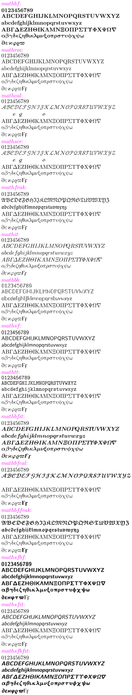

## 19. Ligtures

```tex
%Ligtures
% plain
\text{plain: ff fi fl ffi ffl}
\\
% fractions
\text{fractions: 1/2 3/4 1/5 2/5}
```

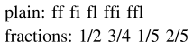

## 20. Greeks

```tex
%Greeks
\Alpha\Beta\Gamma\Delta\Epsilon\Zeta\Eta\Theta\Iota
\Kappa\Lambda\Mu\Nu\Xi\Omicron\Pi\Rho\Sigma\Tau
\Upsilon\Phi\Chi\Psi\Omega\nabla
\\
\alpha\beta\gamma\delta\epsilon\zeta\eta\theta\iota
\kappa\lambda\mu\nu\xi\omicron\pi\rho\sigma\tau
\upsilon\phi\chi\psi\omega
\\
\partial\varepsilon\varkappa\varphi\varrho\varpi
\Digamma\digamma
```

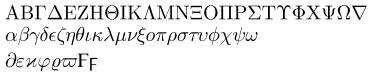

## 21. italics

```tex
%italics
TVYfab
```

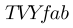

## 22. Z stack test

```tex
%Z stack test
\stackinset{l}{0.2em}{b}{}{%
  \fgcolor{#55ff0000}{\rule{1em}{1em}}
}{%
  \fgcolor{#5500ff00}{\rule{1em}{1em}}
}
\kern10pt
\stackinset{l}{-0.2em}{b}{}{%
  \fgcolor{#55ff0000}{\rule{1em}{1em}}
}{%
  \fgcolor{#5500ff00}{\rule{1em}{1em}}
}
\kern10pt
\stackinset{l}{-0.2em}{b}{}{%
  \fgcolor{#55ff0000}{\rule{2em}{1em}}
}{%
  \fgcolor{#5500ff00}{\rule{1em}{1em}}
}
\kern10pt
\stackinset{l}{-1.1em}{b}{}{%
  \fgcolor{#55ff0000}{\rule{2em}{1em}}
}{%
  \fgcolor{#5500ff00}{\rule{1em}{1em}}
}
\\
\stackinset{c}{}{b}{}{%
  \fgcolor{#55ff0000}{\rule{0.5em}{0.5em}}
}{%
  \fgcolor{#5500ff00}{\rule{1em}{1em}}
}
\kern10pt
\stackinset{c}{-0.1em}{b}{}{%
  \fgcolor{#55ff0000}{\rule{0.5em}{0.5em}}
}{%
  \fgcolor{#5500ff00}{\rule{1em}{1em}}
}
\kern10pt
\stackinset{c}{-0.2em}{b}{}{%
  \fgcolor{#55ff0000}{\rule{2em}{0.5em}}
}{%
  \fgcolor{#5500ff00}{\rule{1em}{1em}}
}
\kern10pt
\stackinset{c}{-1em}{b}{}{%
  \fgcolor{#55ff0000}{\rule{2em}{0.5em}}
}{%
  \fgcolor{#5500ff00}{\rule{1em}{1em}}
}
\\
\stackinset{r}{}{b}{}{%
  \fgcolor{#55ff0000}{\rule{0.5em}{0.5em}}
}{%
  \fgcolor{#5500ff00}{\rule{1em}{1em}}
}
\kern10pt
\stackinset{r}{-0.1em}{b}{}{%
  \fgcolor{#55ff0000}{\rule{0.5em}{0.5em}}
}{%
  \fgcolor{#5500ff00}{\rule{1em}{1em}}
}
\kern10pt
\stackinset{r}{1em}{b}{}{%
  \fgcolor{#55ff0000}{\rule{2em}{0.5em}}
}{%
  \fgcolor{#5500ff00}{\rule{1em}{1em}}
}
\kern10pt
\stackinset{r}{0.5em}{b}{}{%
  \fgcolor{#55ff0000}{\rule{2em}{0.5em}}
}{%
  \fgcolor{#5500ff00}{\rule{1em}{1em}}
}
\\
\stackinset{l}{}{b}{}{%
  \fgcolor{#55ff0000}{f}
}{%
  \fgcolor{#5500ff00}{a}
}
\kern10pt
\stackinset{l}{}{t}{}{%
  \fgcolor{#55ff0000}{f}
}{%
  \fgcolor{#5500ff00}{a}
}
\kern10pt
\stackinset{c}{}{c}{10pt}{%
  \fgcolor{#55ff0000}{a}
}{%
  \fgcolor{#5500ff00}{f}
}
\kern10pt
\stackinset{c}{}{c}{-.3ex}{*}{0}
\\
\stackinset{c}{}{B}{}{%
  \fgcolor{#55ff0000}{a}
}{%
  \fgcolor{#5500ff00}{f}
}
\stackinset{c}{}{B}{0.1em}{%
  \fgcolor{#55ff0000}{a}
}{%
  \fgcolor{#5500ff00}{f}
}
\stackinset{c}{}{B}{-0.1em}{%
  \fgcolor{#55ff0000}{a}
}{%
  \fgcolor{#5500ff00}{f}
}
```

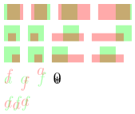

## 23. Scripts test

```tex
%Scripts test
f_a {f_a}_a f^a \hat{f}^a {f^a}^a \\
a_x^2 f_x^2 f_{M=0}^{+\infty} A_x^2 \\
f_{\overset{!}{=}}^{\overset{\delta}{2}}
f_{\stackrel[a]{M=0}{f}}a
\stackinset{l}{}{B}{}{
  \fgcolor{#55ff0000}{\sum_x^y}
}{
  \fgcolor{#550000ff}{\sum_x}
}\\
% with math kern
\Gamma_x^y\Tau_x^y\\
% boxed
{maf}_x^y\\
{ma\sum}_x^ya\\
\sum_{x_{x_x}}^{y^{y^y}}
```

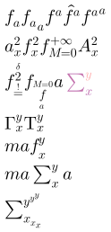

## 24. Stack test

```tex
%Stack test
\stackrel[a]{!}{=}\\
\stackrel[f]{!}{=}\\
\stackrel[!]{f}{=}\\
\stackrel[a]{M=0}{=}
```

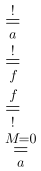

## 25. Orphan symbols

```tex
%Orphan symbols
\imath\jmath\nabla\partial\epsilon\vartheta\phi
\varkappa\varrho\varpi
```

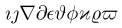

## 26. Accent test

```tex
%Accent test
\hat{a}\check{a}\tilde{a}\acute{a}\dot{a}\ddot{a}
\breve{a}\bar{a}\vec{a}\mathring{a}
\hat{,}\\
\widehat{aa}\widetilde{abcd}
\hat{\hat{A}}
\\
%fake accent
\accentset{\star}{d}
\accentset{\diamond}{h}
\tilde{\accentset{\circ}{\phi}}
```

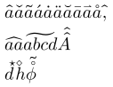

## 27. Cyrillic and Greek alphabet

```tex
%Cyrillic and Greek alphabet
\begin{array}{lr}
    \mbox{\textcolor{Blue}{Russian}}&\mbox{\textcolor{Melon}{Greek}}\\
    \mbox{привет мир}&\mbox{γειά κόσμο}\\
    \mbox{привет мир}&\mbox{γειά κόσμο}\\
    \textbf{\mbox{привет мир}}&\textbf{\mbox{γειά κόσμο}}\\
    \textit{\mbox{привет мир}}&\textit{\mbox{γειά κόσμο}}\\
    \textsf{\mbox{привет мир}}&\textsf{\mbox{γειά κόσμο}}\\
    \texttt{\mbox{привет мир}}&\texttt{\mbox{γειά κόσμο}}\\
    \textbf{\textit{\mbox{привет мир}}}&\textbf{\textit{\mbox{γειά κόσμο}}}\\
    \textbf{\textsf{\mbox{привет мир}}}&\textbf{\textsf{\mbox{γειά κόσμο}}}\\
    \textsf{\textit{\mbox{привет мир}}}&\textsf{\textit{\mbox{γειά κόσμο}}}\\
    &\\
    \mbox{\textcolor{Salmon}{Bulgarian}}&\mbox{\textcolor{Tan}{Serbian}}\\
    \mbox{здравей свят}&\mbox{Хелло уорлд}\\
    &\\
    \mbox{\textcolor{Turquoise}{Bielorussian}}&\mbox{\textcolor{LimeGreen}{Ukrainian}}\\
    \mbox{прывітаньне Свет}&\mbox{привіт світ}\\
\end{array}
```

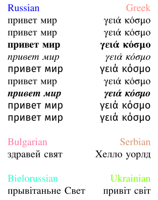

## 28. Complex formula test

```tex
%Complex formula test
\begin{array}{l}
  \forall\varepsilon\in\mathbb{R}_+^*\ \exists\eta>0\ |x-x_0|\leq\eta\Longrightarrow|f(x)-f(x_0)|\leq\varepsilon\\
  \det
  \begin{bmatrix}
      a_{11}&a_{12}&\cdots&a_{1n}\\
      a_{21}&\ddots&&\vdots\\
      \vdots&&\ddots&\vdots\\
      a_{n1}&\cdots&\cdots&a_{nn}
  \end{bmatrix}
  \overset{\mathrm{def}}{=}\sum_{\sigma\in\mathfrak{S}_n}\varepsilon(\sigma)\prod_{k=1}^n a_{k\sigma(k)}\\
  \sideset{_\alpha^\beta}{_\gamma^\delta}{\begin{pmatrix}a&b\\c&d\end{pmatrix}}\\
  \int_0^\infty{x^{2n} e^{-a x^2}\,dx} = \frac{2n-1}{2a} 
      \int_0^\infty{x^{2(n-1)} e^{-a x^2}\,dx} = \frac{(2n-1)!!}{2^{n+1}} \sqrt{\frac{\pi}{a^{2n+1}}}\\
  \int_a^b{f(x)\,dx} = (b - a) \sum\limits_{n = 1}^\infty  
      {\sum\limits_{m = 1}^{2^n  - 1} {\left( { - 1} \right)^{m + 1} } } 2^{ - n} f(a + m\left( {b - a} \right)2^{-n} )\\
  \int_{-\pi}^{\pi} \sin(\alpha x) \sin^n(\beta x) dx = \textstyle{\left \{
      \begin{array}{cc}
          (-1)^{(n+1)/2} (-1)^m \frac{2 \pi}{2^n} \binom{n}{m} & n \mbox{ odd},\ \alpha = \beta (2m-n) \\
          0 & \mbox{otherwise} \\ \end{array} \right .}\\
  L = \int_a^b \sqrt{ \left|\sum_{i,j=1}^ng_{ij}(\gamma(t))\left(\frac{d}{dt}x^i\circ\gamma(t)\right)
      \left(\frac{d}{dt}x^j\circ\gamma(t)\right)\right|}\,dt\\
  \begin{array}{rl}
      s &= \int_a^b\left\|\frac{d}{dt}\vec{r}\,(u(t),v(t))\right\|\,dt \\
      &= \int_a^b \sqrt{u'(t)^2\,\vec{r}_u\cdot\vec{r}_u + 2u'(t)v'(t)\, \vec{r}_u\cdot
          \vec{r}_v+ v'(t)^2\,\vec{r}_v\cdot\vec{r}_v}\,\,\, dt. 
  \end{array}\\
\end{array}
```

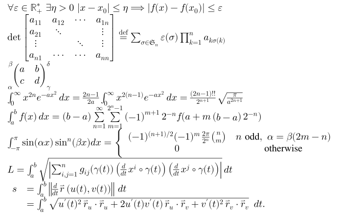

## 29. Sample 29

```tex
\definecolor{gris}{gray}{0.9}
\definecolor{noir}{rgb}{0,0,0}
\definecolor{bleu}{rgb}{0,0,1}
\fatalIfCmdConflict{false}
\newcommand{\pa}{\left|}
\begin{array}{c}
  \LaTeX\\
  \begin{split}
      |I_2| &= \pa\int_0^T\psi(t)\left\{ u(a,t)-\int_{\gamma(t)}^a \frac{d\theta}{k} (\theta,t) \int_a^\theta c(\xi) 
          u_t (\xi,t)\,d\xi\right\}dt\right|\\
      &\le C_6 \Bigg|\pa f \int_\Omega \pa\widetilde{S}^{-1,0}_{a,-}
          W_2(\Omega, \Gamma_1)\right|\ \right|\left| |u|\overset{\circ}{\to} W_2^{\widetilde{A}}(\Omega\Gamma_r,T)\right|\Bigg|\\
      &\\
      &\begin{pmatrix}
          \alpha&\beta&\gamma&\delta\\
          \aleph&\beth&\gimel&\daleth\\
          \mathfrak{A}&\mathfrak{B}&\mathfrak{C}&\mathfrak{D}\\
          \boldsymbol{\mathfrak{a}}&\boldsymbol{\mathfrak{b}}&\boldsymbol{\mathfrak{c}}&\boldsymbol{\mathfrak{d}}
      \end{pmatrix}
      \quad{(a+b)}^{\frac{n}{2}}=\sqrt{\sum_{k=0}^n\tbinom{n}{k}a^kb^{n-k}}\quad 
          \Biggl(\biggl(\Bigl(\bigl(()\bigr)\Bigr)\biggr)\Biggr)\\
      &\forall\varepsilon\in\mathbb{R}_+^*\ \exists\eta>0\ |x-x_0|\leq\eta\Longrightarrow|f(x)-f(x_0)|\leq\varepsilon\\
      &\det
      \begin{bmatrix}
          a_{11}&a_{12}&\cdots&a_{1n}\\
          a_{21}&\ddots&&\vdots\\
          \vdots&&\ddots&\vdots\\
          a_{n1}&\cdots&\cdots&a_{nn}
      \end{bmatrix}
      \overset{\mathrm{def}}{=}\sum_{\sigma\in\mathfrak{S}_n}\varepsilon(\sigma)\prod_{k=1}^n a_{k\sigma(k)}\\
      &\Delta f(x,y)=\frac{\partial^2f}{\partial x^2}+\frac{\partial^2f}{\partial y^2}\qquad\qquad \fcolorbox{noir}{gris}
          {n!\underset{n\rightarrow+\infty}{\sim} {\left(\frac{n}{e}\right)}^n\sqrt{2\pi n}}\\
      &\sideset{_\alpha^\beta}{_\gamma^\delta}{
      \begin{pmatrix}
          a&b\\
          c&d
      \end{pmatrix}}
      \xrightarrow[T]{n\pm i-j}\sideset{^t}{}A\xleftarrow{\overrightarrow{u}\wedge\overrightarrow{v}}
          \underleftrightarrow{\iint_{\mathds{R}^2}e^{-\left(x^2+y^2\right)}\,\mathrm{d}x\mathrm{d}y}
  \end{split}\\
  \rotatebox{30}{\sum_{n=1}^{+\infty}}\quad\mbox{Mirror rorriM}\reflectbox{\mbox{Mirror rorriM}}
\end{array}
```

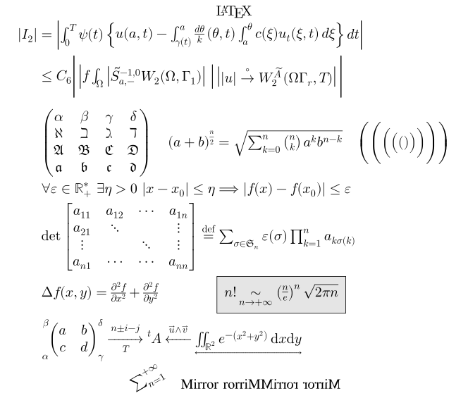

## 30. Sample 30

```tex
\begin{array}{|c|l|||r|c|}
  \hline
  \text{Matrix}&\multicolumn{2}{|c|}{\text{Multicolumns}}&\text{Font sizes commands}\cr
  \hline
  \begin{pmatrix}
      \alpha_{11}&\cdots&\alpha_{1n}\cr
      \hdotsfor{3}\cr
      \alpha_{n1}&\cdots&\alpha_{nn}
  \end{pmatrix}
  &\Large \text{Large Right}&\small \text{small Left}&\tiny \text{tiny Tiny}\cr
  \hline
  \multicolumn{4}{|c|}{\Huge \text{Huge Multicolumns}}\cr
  \hline
\end{array}
```

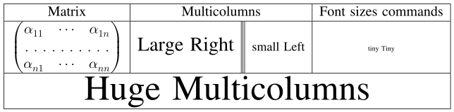

## 31. Sample 31

```tex
\cornersize{0.2}
\begin{array}{cc}
  \fbox{\text{A framed box with 🥰}}&\shadowbox{\text{A shadowed box}}\cr
  \doublebox{\text{A double framed box}}&\ovalbox{\text{An oval framed box}}\cr
\end{array}
```

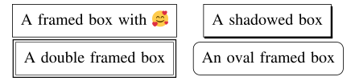

## 32. Table test

```tex
%Table test
\newcolumntype{s}{>{\color{#1234B6}}c}
\begin{array}{|c|c|c|s|}
  \hline
  \rowcolor{Tan}\multicolumn{4}{|c|}{\textcolor{white}{\bold{\text{Table Head}}}}\\
  \hline
  \text{Matrix}&\multicolumn{2}{|c|}{\text{Multicolumns}}&\text{Font size commands}\\
  \hline
  \begin{pmatrix}
      \alpha_{11}&\cdots&\alpha_{1n}\\
      \hdotsfor{3}\\
      \alpha_{n1}&\cdots&\alpha_{nn}
  \end{pmatrix}
  &\large \text{Left}&\cellcolor{#00bde5}\small \textcolor{white}{\text{\bold{Right}}}
  &\small \text{small Small}\\
  \hline
  \multicolumn{4}{|c|}{\text{Table Foot}}\\
  \hline
\end{array}
```

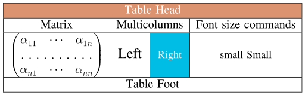

## 33. Sample 33

```tex
\rlap{\overbrace{\phantom{1 + a + b + \cdots + z}}^{\text{total + 1}}}
1 + \underbrace{a + b + \cdots + z}_{\text{total}}
\\
\frac{a\cancel{b}}{\cancel{b}} = a;
\frac{a\bcancel{b}}{\bcancel{b}} = a;
\frac{a\xcancel{b}}{\xcancel{b}} = a;
\\
\text{A long division: }\longdiv{12345}{13}
```

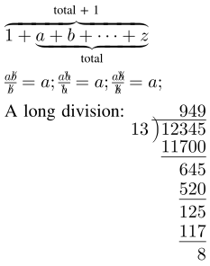

## 34. Sample 34

```tex
\left\{
    \begin{array}{l}
    2a < -1,\\
    a + 8 \ge 5,
    \end{array}
\right.
\\
P_{r-j}=\begin{cases}
0& \text{if $r-j$ is odd},\\
r!\,(-1)^{(r-j)/2}& \text{if $r-j$ is even}.
\end{cases}\text{Cases}
\\
P_{r-j}=\left\{\begin{array}{@{}ll@{\,}}
0& \text{if $r-j$ is odd},\\
r!\,(-1)^{(r-j)/2}& \text{if $r-j$ is even}.
\end{array}\right.\text{Cases}
\\
P_{r-j}=\begin{cases}
4-x\geq 0 \\
3-x\geq 1
\end{cases}\text{Cases}
\\
\left\{\begin{array}{@{}ll}
1 & 2\\
3 & 4
\end{array}\right.\text{Equation}
\\
\left\{\begin{array}{l@{}l}
1 & 2\\
3 & 4
\end{array}\right.\text{Equation}
\\
\left\{\begin{array}{ll@{}}
1 & 2\\
3 & 4
\end{array}\right.\text{Equation}
\\
\begin{split}
H_c&=\frac{1}{2n} \sum^n_{l=0}(-1)^{l}(n-{l})^{p-2}
\sum_{l _1+\dots+ l _p=l}\prod^p_{i=1} \binom{n_i}{l _i}\\
&\quad\cdot[(n-l )-(n_i-l _i)]^{n_i-l _i}\cdot
\Bigl[(n-l )^2-\sum^p_{j=1}(n_i-l _i)^2\Bigr].
\end{split}
\\
\begin{align}
A_1&=N_0(\lambda;\Omega')-\phi(\lambda;\Omega'),\\
A_2&=\phi(\lambda;\Omega')-\phi(\lambda;\Omega),\\
\intertext{and}
A_3&=\mathcal{N}(\lambda;\omega).
\end{align}
```

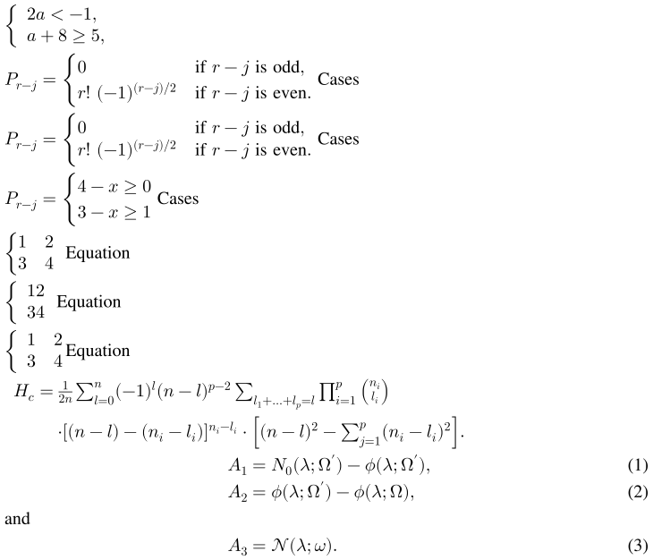

## 35. Sample 35

```tex
\frac{\sum_{n > 0} z^n}
{\prod_{1\leq k\leq n} (1-q^k)}
\\
\frac{{\displaystyle\sum_{n > 0} z^n}}
{{\displaystyle\prod_{1\leq k\leq n} (1-q^k)}}
\\
\frac{{\displaystyle\sum\nolimits_{n> 0} z^n}}
{{\displaystyle\prod\nolimits_{1\leq k\leq n} (1-q^k)}}
```

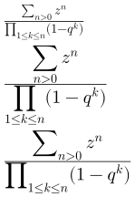

## 36. Sample 36

```tex
\cfrac{1}{\sqrt{2}+
\cfrac{1}{\sqrt{2}+
\cfrac{1}{\sqrt{2}+\dotsb
}}}
\\
\biggl[
\sum_i a_i\biggl\lvert\sum_j x_{ij}
\biggr\rvert^p\biggr]^{1/p}
\\
\biggl[
\sum_i a_i\Bigl\lvert\sum_j x_{ij}
\Bigr\rvert^p\biggr]^{1/p}
```

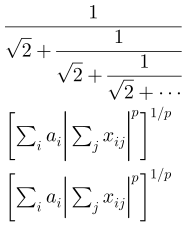

